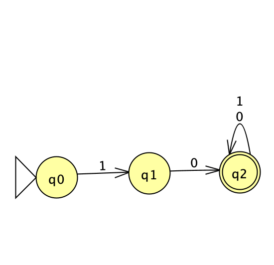
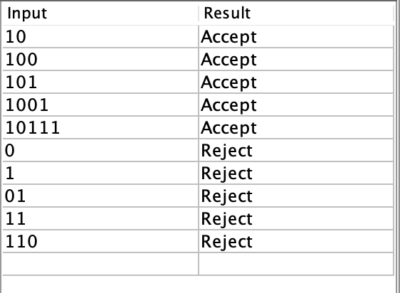

# Problem 6

Language: Strings that start with 10.

## NFA

## Multiple Run Results

## Notes

The NFA checks whether the string begins with 10. After reading 10, the machine reaches the accepting state. Any additional 0s or 1s are accepted because the final state loops on both symbols.