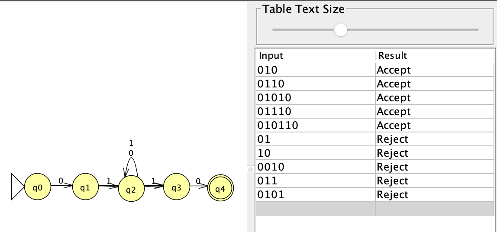
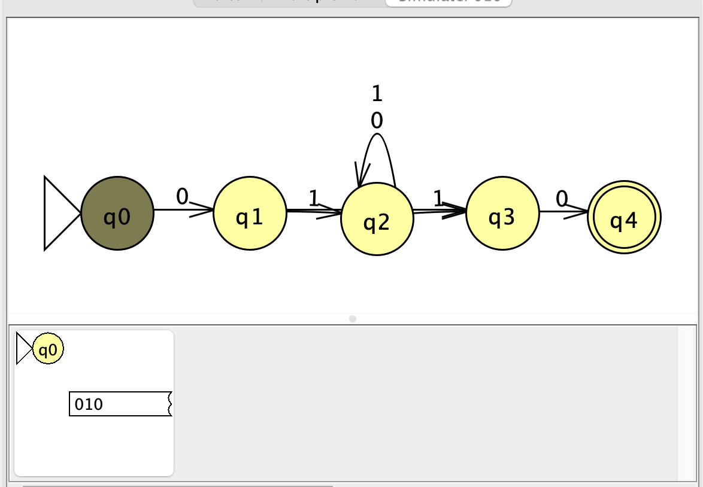
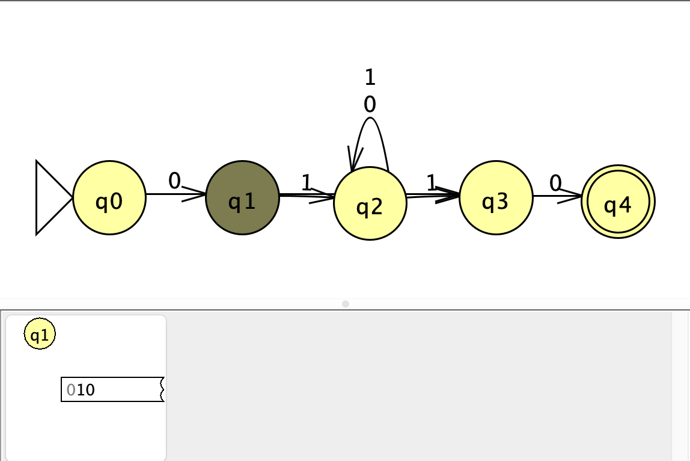
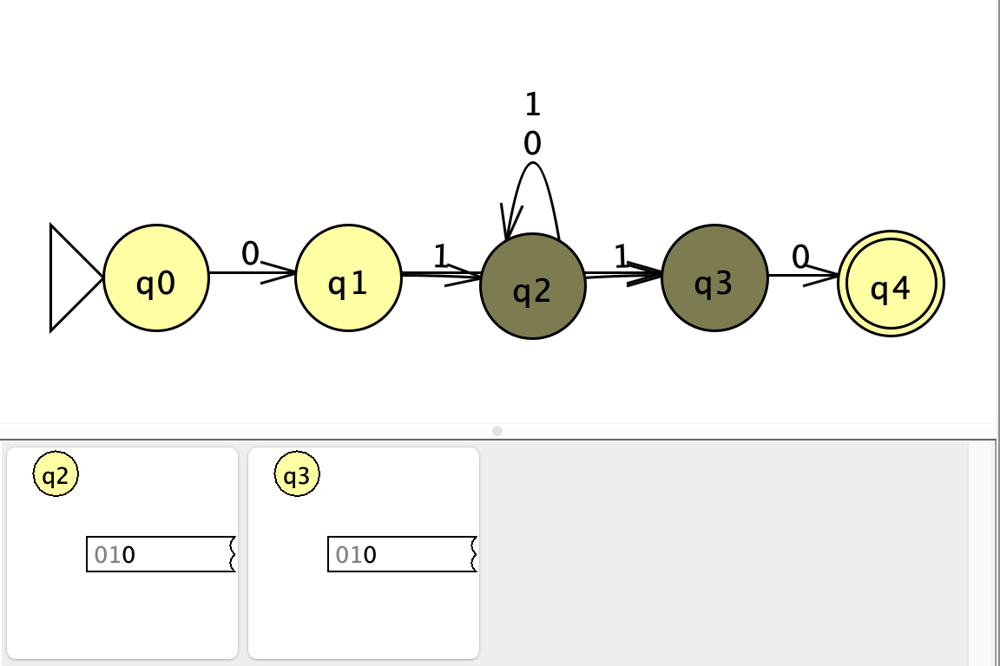
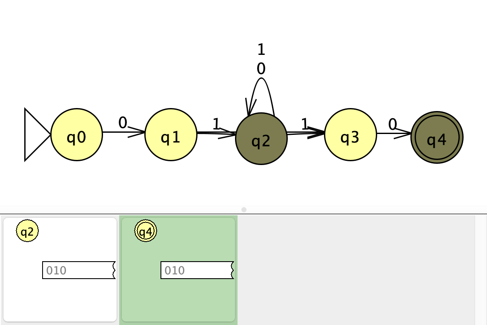

# Problem 8

Language: Strings that start with 01 and end with 10.

## NFA

## Gold String: 010

The string `010` was a useful corner case because the middle `1` is part of both the starting pattern `01` and the ending pattern `10`.

At first, I only had the transition from `q1` to `q2` on `1`, which caused `010` to be rejected. I fixed it by also adding a transition from `q1` to `q3` on `1`.

This allows the NFA to branch into two possible states after reading the `1`.

### Step-by-Step Run

