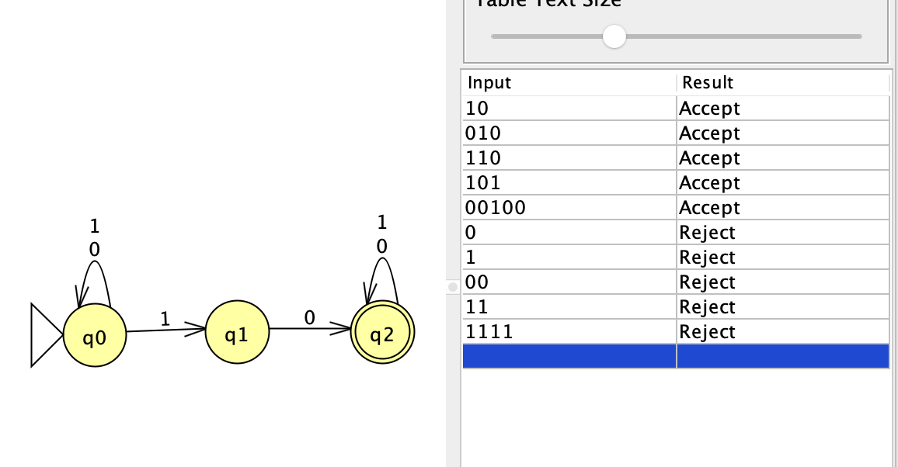

# Problem 9

Language: Strings that contain the substring 10.

## NFA

## Notes

The NFA searches for the substring `10`. From the start state, it can keep reading symbols while also guessing that a `1` may be the beginning of the substring. Once `10` is found, the machine reaches the accepting state and any remaining symbols are allowed.