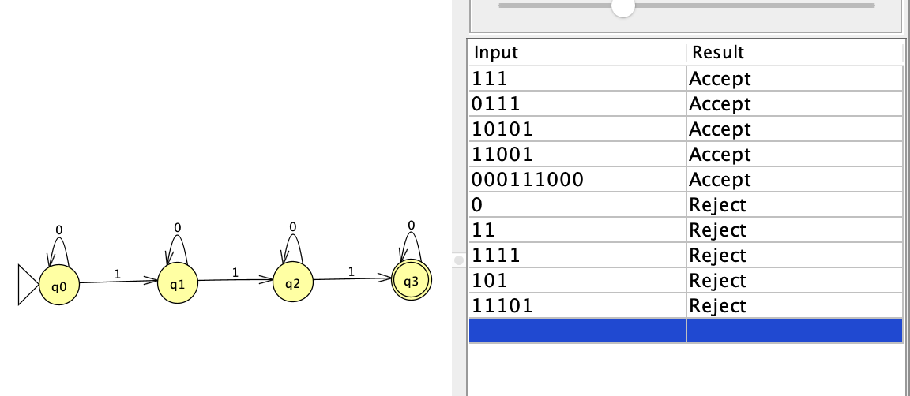

# Problem 12

Language: Strings that contain exactly 3 1's.

## NFA

## Notes

Each transition labeled `1` increases the count of 1's by one. The machine accepts only after exactly three 1's have been read. Zeros do not change the count, so each state has a loop on `0`. There is no transition on `1` from the final state, so any string with more than three 1's is rejected.