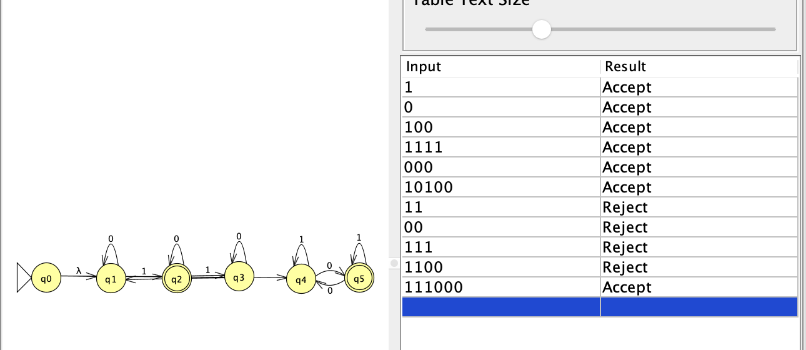

# Problem 20

Language: Strings with 3k+1 1's, where k ≥ 0, OR an odd number of 0's.

## NFA

## Notes

The NFA splits into two branches using lambda transitions.

The first branch keeps track of the number of 1's modulo 3. It accepts when the number of 1's is 1 mod 3.

The second branch keeps track of whether the number of 0's is odd or even. It accepts when the number of 0's is odd.

Since this is an OR condition, the string is accepted if either branch reaches a final state.